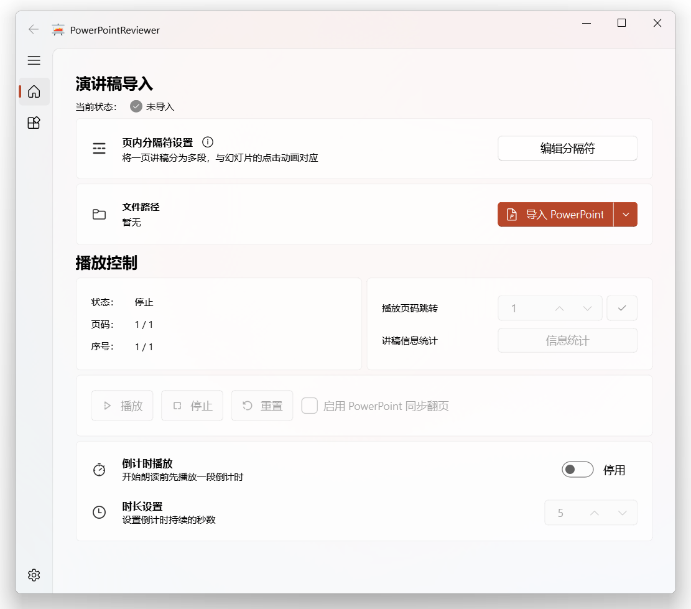

<div align="center">
  
  <h1>PowerPointReviewer</h1>
  <p>PowerPoint 讲稿朗读与审阅工具</p>

  <p>
    <a href="https://gitee.com/pth2000/PowerPointReviewer/releases">下载（Gitee）</a>
    &nbsp; · &nbsp;
    <a href="https://github.com/pth2000/PowerPointReviewer/releases/latest">下载（GitHub）</a>
    &nbsp; · &nbsp;
    <a href="#使用方法">使用方法</a>
    &nbsp; · &nbsp;
    <a href="CHANGELOG.md">更新日志</a>
    &nbsp; · &nbsp;
    <a href="https://github.com/pth2000/PowerPointReviewer/issues">反馈问题</a>
  </p>
</div>



## 项目简介

一个基于PySide6实现的演讲稿朗读审阅工具，使用TTS引擎朗读PPT中的备注部分，从而辅助您进一步完善演讲的内容与措辞，助您顺利完成精彩的PPT演讲与展示。

## 基本特性

- 基于Python、PySide6、PySide6-Fluent-Widgets实现
- 支持从 PPT 备注导入演讲稿，也可从 Word / JSON 讲稿文件导入
- 支持编辑页内分隔符，用于在一页PPT中执行点击效果
- 支持朗读前插入并设置倒计时
- 支持PPT同步翻页功能
- 支持停止朗读后重新从当前语句开始朗读
- 支持页码跳转
- 支持统计演讲稿信息
- 支持文件拖入导入
- 支持导出 PPT备注、Markdown、SRT字幕、音频文件（逐条或合并）及工程包格式
- 支持导出PPT放映视频，包括放映录制和静态合成两种方式
- 支持多TTS引擎切换与参数独立保存
- 支持在线TTS引擎（Edge / 阿里百炼 / 千问复刻）
- 支持连接本机或局域网的 qwentts.cpp 服务，使用本地模型合成语音
- 支持AI改写讲稿，兼容 OpenAI 格式
- 支持历史记录与会话恢复，可重新关联移动或改名后的 PPT
- 支持更新 PPT 讲稿及 Word / JSON 往返编辑，复用未变更片段的配音
- 支持逐段审听配音，调整语速、音量和头尾留白，支持撤销与重做
- 支持讲稿注释，以及生成前的空讲稿与点击动画校验，可在设置中开启或关闭
- 支持切换界面字体
- 支持检查更新

## TTS引擎说明

当前内置5种引擎：

- 本地 TTSx3：离线可用，稳定，适合无网场景
- 在线 Edge-TTS：配置简单，音色自然，支持切换语言地区
- 在线 阿里百炼 CosyVoice：可配置模型/语速/音量/音调
- 在线 千问音色复刻：支持云端复刻音色，支持 Qwen-Audio-TTS 3.1 Flash、3.0 系列模型
- 本地 qwentts.cpp：连接已启动的本地服务，支持模型与音色读取、试听和批量合成

## 使用方法

1. 在设置页选择 TTS 引擎和发音人，试听后保存设置。
2. 在 PPT 备注中准备讲稿。一页内有点击动画时，用分隔符将备注分段，默认使用 `●`，可在主页修改。
3. 点击主页的“导入 PowerPoint”，或将文件拖入窗口，生成讲稿配音。
4. 点击“播放”审听，按需启用倒计时或同步翻页。放映方式与联动偏好可在设置的“放映控制”中调整。
5. 在“实用工具”中逐段调整配音、优化讲稿，或导出文档、字幕、音频和视频。

首次使用可查看入门指引，完成后可继续了解进阶技巧。两种指引均可在“设置 → 常规 → 使用指引”中重新查看。

### 修改讲稿

修改并保存 PPT 备注后，点击主页的更新提醒，或在导入菜单中选择“更新 PPT 讲稿”。确认后会替换当前讲稿，包括已有的编辑和 AI 改写。更新沿用当前历史记录，复用未变更片段的配音，并保留所在页。

Word / JSON 讲稿可导出编辑后再导入，按页更新已关联 PPT 的讲稿。未关联 PPT 时也可独立导入和播放配音，同步翻页、视频导出和写回 PPT 备注需先关联文稿。

### 恢复历史记录

从导入菜单的“历史记录列表”可恢复已有讲稿和配音。PPT 移动或改名后，可在记录中点击“关联 PPT”重新选择。

### 调整配音

在“实用工具 → 配音审听”中，可逐段或批量调整语速、音量和头尾留白。对比试听后点击“采用新配音”，调整将用于正常播放和导出，支持撤销、重做。

### 导出视频

导出视频时，“放映录制”保留 PPT 动画，“静态合成”使用逐页静态画面。视频导出需安装 PowerPoint 或 WPS，放映录制需要 Windows 10 2004 或更新版本。录制时请勿最小化放映窗口或手动翻页，后台动画暂停时可尝试窗口放映。

## AI 优化

在“实用工具 → AI 优化”中选择页面与场景。“朗读纠错”保留正文，重点处理缩写、数字和单位的读法。其他场景包括汇报讲解、教学讲解和精简讲解。

在“设置任务”中，可配置 OpenAI 兼容接口直接处理，或选择“外部处理”，通过“导出优化任务”复制含提示词的讲稿，在其他 AI 中处理后“导入优化结果”。在“审查结果”中左右对照原文与修改，勾选确认的页面后应用。

## 格式规范

为了便于快速上手，本项目提供PPT模板和Word模板，在本项目的`example`目录下。

您可以使用本软件导入，快速预览效果，了解其实现方式。

## 进阶使用

### 本地 NaturalVoiceSAPIAdapter 接入

在Windows系统中，“本地 · TTSx3”通过调用 SAPI 5 text-to-speech (TTS) engine 实现，默认引擎均为微软的普通语音包，发音较为生硬。

推荐本地部署[NaturalVoiceSAPIAdapter](https://github.com/gexgd0419/NaturalVoiceSAPIAdapter)，能够为本软件提供微软自然语音的SAPI 5 TTS引擎。下载本地自然语音包后，启动相关功能即可，具体部署方法请参见该项目文档。

### 本地 qwentts.cpp 接入

兼容 [ServeurpersoCom 原始项目](https://github.com/ServeurpersoCom/qwentts.cpp) 与 [Panda-Panta Windows 便携版](https://github.com/Panda-Panta/qwentts.cpp/releases)。模型下载和服务启动在 qwentts.cpp 中完成，本软件负责连接服务并生成讲稿音频。

1. 按对应项目说明准备 GGUF 模型并启动服务。Windows 便携版可解压后运行 `Qwen3-TTS-Launcher.exe`，选择模型、语言并启动；原始项目使用 `tts-server` 启动 HTTP 服务。
2. 在本软件设置页选择“本地 · qwentts.cpp”，填写后端服务地址，默认 `http://127.0.0.1:8080`。
3. 点击“测试连接”，读取当前模型与音色，再选择音色。
4. 按需调整设置，点击试听确认效果，再保存设置。
5. 导入讲稿或重新生成音频。

使用 Windows 便携版的 Base 克隆模型时，可先在服务网页中创建复刻音色，再回本软件刷新音色列表。

## 如何打包

本项目提供 Windows 64 位可执行文件。如果您想从源码运行或打包，可在 Windows 64 位 Python 环境中安装依赖：

```shell
python -m pip install -r requirements.txt
python main.py
```

使用pyinstaller：

```shell
python -m pip install pyinstaller
python -m PyInstaller PowerPointReviewer.spec
```

如需生成安装器、便携包和增量更新包，先安装 .NET SDK 与 Velopack CLI（`vpk`），再执行：

```shell
python build.py --notes CHANGELOG.md
```

最新版本的更新内容见 [CHANGELOG.md](CHANGELOG.md)。

如果遇到任何bug，或者有任何建议，欢迎提交issue，谢谢。
